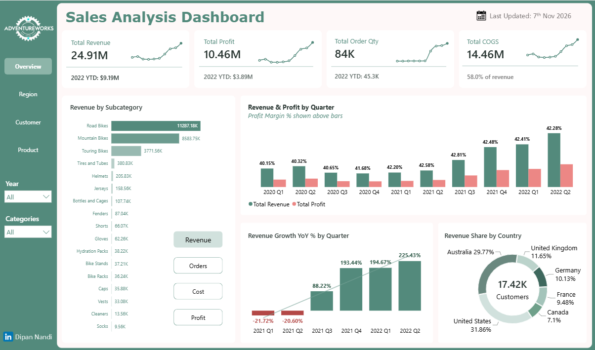
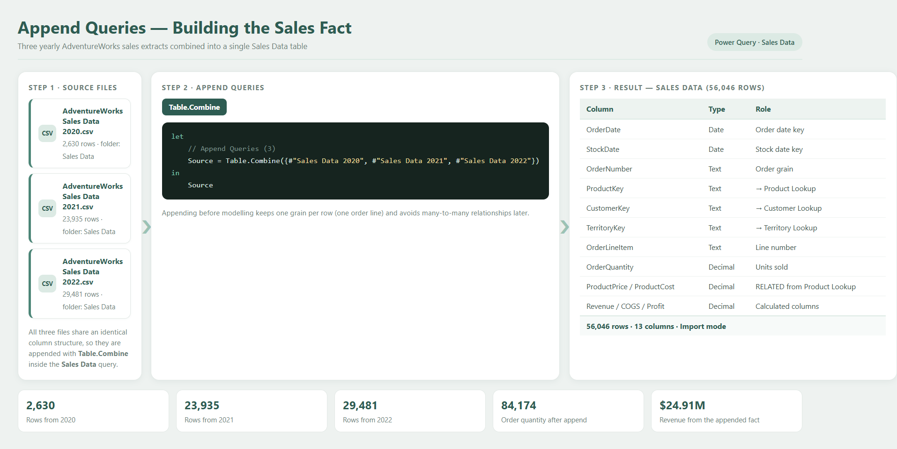
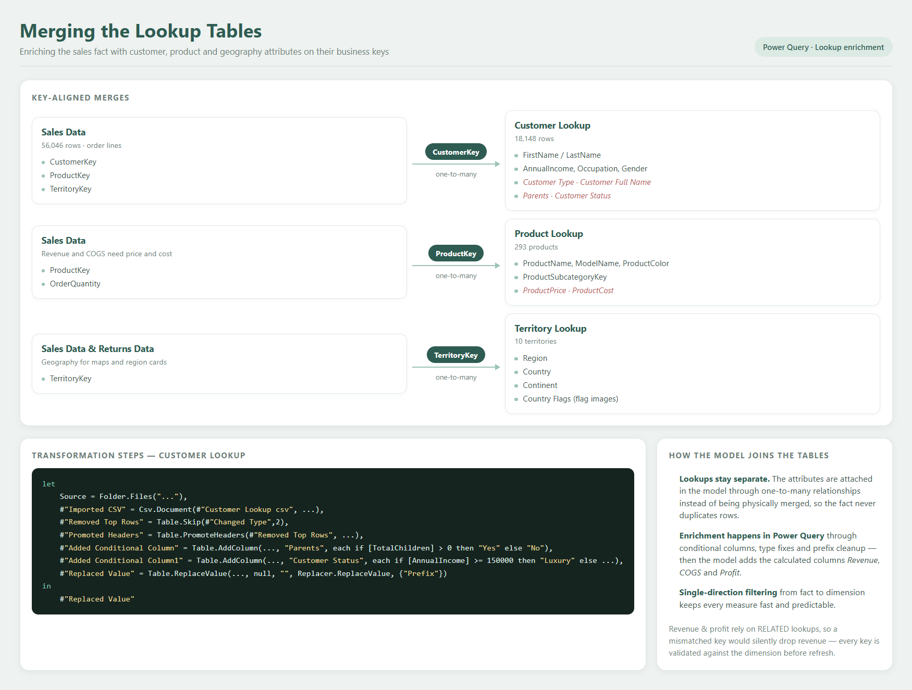
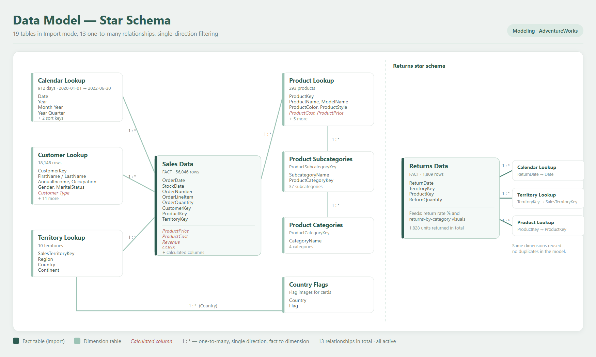
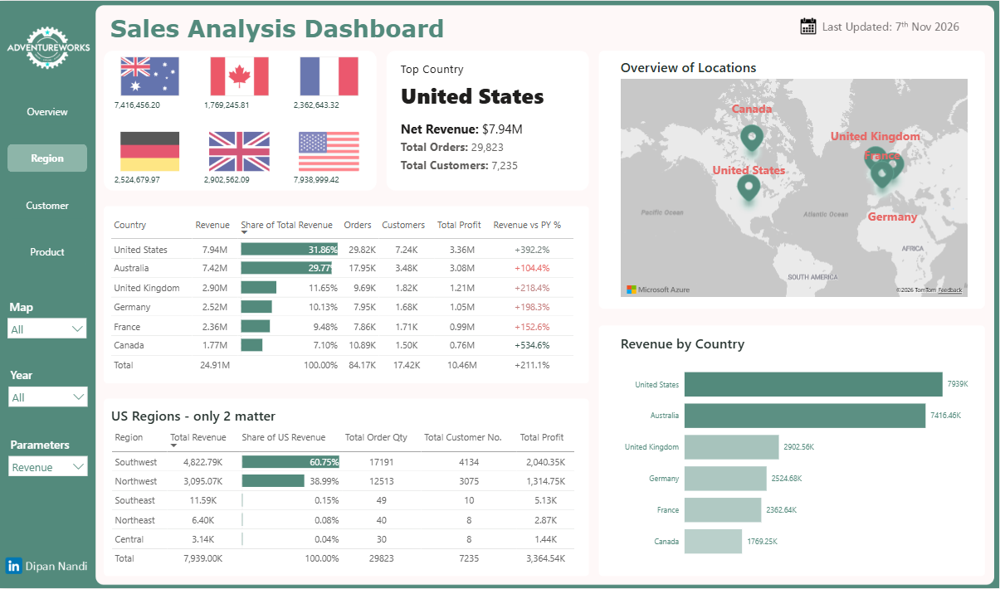
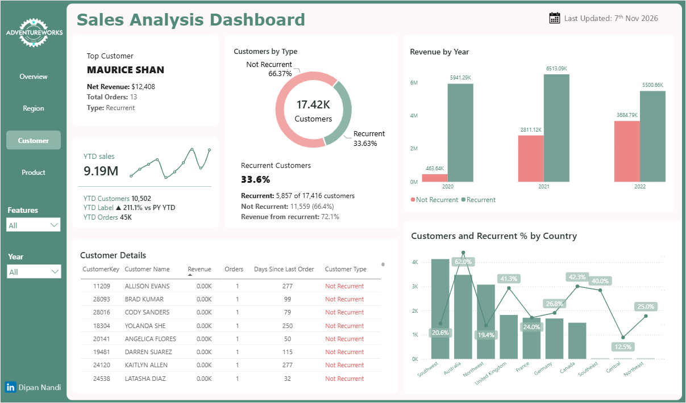
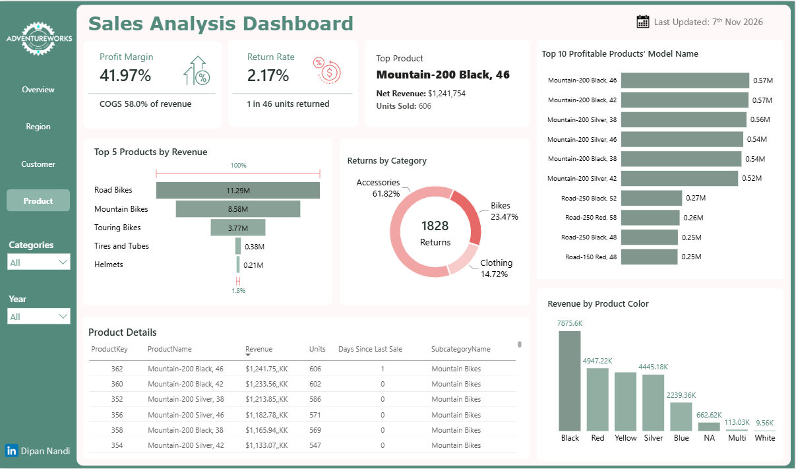

# AdventureWorks Sales Analysis using Power BI

An end-to-end Business Intelligence project that transforms raw AdventureWorks sales data into interactive dashboards using Power Query, Data Modeling, DAX, and Time Intelligence.

---

# Dashboard Preview



---

# Project Overview

This project demonstrates the complete Power BI analytics workflow, from raw data preparation to interactive business reporting.

### Objectives

- Transform raw sales data into an analytical model
- Build a scalable star schema
- Develop reusable DAX measures
- Apply Time Intelligence calculations
- Design interactive dashboards
- Generate actionable business insights

---

# Business Problem

Business data is often spread across multiple tables, making it difficult to monitor performance and identify trends efficiently.

This project consolidates sales, customer, product, and geography data into a centralized reporting solution that enables decision-makers to analyze performance through interactive dashboards.

---

# Tools & Technologies

- Microsoft Power BI Desktop
- Power Query
- DAX
- Data Modeling

---

# Project Workflow


---

# Dataset

**Dataset:** Microsoft AdventureWorks

The dataset contains information related to:

- Sales
- Customers
- Products
- Product Categories
- Geography
- Calendar
- Product Returns

| Source | Rows |
|---|---|
| Sales Data 2020 / 2021 / 2022 | 56,046 |
| Customer Lookup | 18,148 |
| Product Lookup (37 subcategories, 4 categories) | 293 |
| Territory Lookup | 10 |
| Calendar Lookup | 912 days |
| Returns Data | 1,809 |

---

# Data Preparation (Power Query)

Power Query was used to clean, transform, and prepare the data before analysis.

### Tasks Performed

- Appended the three yearly sales files into one fact table
- Promoted headers and corrected data types on every extract
- Removed stray top rows from the customer extract
- Added conditional columns (Parents, Customer Status)
- Built a continuous calendar table with sorted year and quarter labels
- Cleaned prefixes and replaced blank values

### Append Queries — building the sales fact



### Merging the lookup tables



### Date table


---

# Data Modeling

A star schema was implemented to improve report performance and simplify analytical calculations.

### Model Highlights

- Two fact tables: **Sales Data** and **Returns Data**
- Six dimensions: Customer, Product, Territory, Calendar, Subcategory, Category
- **13 relationships**, all one-to-many and single direction
- Calendar Lookup marked as the model date table
- Calculated columns for **Revenue**, **COGS** and **Profit**
- All 19 tables loaded in Import mode



---

# DAX Development

Business metrics were developed using DAX to support dynamic reporting and analysis. The model carries **175 measures** across two measure tables, split into display folders such as Base, KPI Cards, Trend Chart and per-page packs.

### Core KPIs

- Total Revenue
- Total COGS
- Total Profit
- Profit %
- Total Order Qty
- Total Customer No.


### Time Intelligence

- Previous Year Sales
- Year-over-Year Growth
- Year-to-Date calculations
- Month-over-Month growth


### DAX Features

- Measures
- Variables (VAR)
- RELATED
- DIVIDE
- IF
- SWITCH
- Time Intelligence

---

# Dashboard Pages

## Overview Dashboard

Provides an executive overview of overall business performance.

### Highlights

- Revenue, Profit, Order Qty and COGS KPIs
- Profit Margin
- Revenue & Profit by Quarter
- Revenue by Subcategory
- YoY Revenue Growth by Quarter
- Revenue Share by Country
- Dynamic Business Summary


---

## Regional Dashboard

Analyzes business performance across different geographical locations.

### Highlights

- Country Flag Cards with Revenue
- Top Country Summary (Revenue, Orders, Customers)
- Interactive Map of Locations
- Country Performance Table (Revenue, Share, Orders, Customers, Profit, YoY)
- Revenue by Country Ranking
- US Regional Breakdown
- Parameter-driven Region, Year and Metric Filters



---

## Customer Dashboard

Provides customer-focused sales analysis.

### Highlights

- Top Customer Summary (Revenue, Orders, Type)
- Customers by Type (Recurrent vs Not Recurrent)
- Revenue by Year split by Customer Type
- YTD Sales Sparkline with PY comparison
- Customer Details Table with Days Since Last Order
- Customers and Recurrent % by Country
- Feature and Year Filters



---

## Product Dashboard

Provides detailed product performance analysis.

### Highlights

- Profit Margin and Return Rate KPIs
- Top Product Summary (Revenue, Units Sold)
- Top 10 Profitable Products by Model Name
- Top 5 Products by Revenue
- Returns by Category
- Revenue by Product Color
- Product Details Table with Days Since Last Sale
- Category and Year Filters



---

# Key Insights

- Generated over **$24.91M** in total revenue.
- Achieved **$10.46M** in total profit with a **41.97%** profit margin (COGS at 58.0% of revenue).
- Scaled to **84,174** order quantity across **17,416** customers.
- Bikes contributed the largest share of revenue and profitability; *Mountain-200 Black, 46* was the top product at **$1.24M**.
- The **United States** was the strongest market (**$7.94M**, 31.86% of revenue), closely followed by **Australia** (29.77%).
- Recurrent customers were only **33.63%** of the base but drove **72.1%** of revenue.
- Return rate was **2.17%** (1 in 46 units returned).
- Revenue showed consistent growth across the reporting period.
- Interactive filtering enables flexible analysis by geography, customer, product, and time.

---

# Project Structure

```
adventureworks-sales-dash-analysis-powerbi/
├── dashboard/          # Dashboard page screenshots
│   ├── Overview_dash.png
│   ├── Region_dash.png
│   ├── Customer_dash.png
│   └── Product_dash.png
├── images/             # Pipeline, Power Query, model and DAX visuals
│   ├── AdventureWorks Data Pipeline.png
│   ├── Append.png
│   ├── Merge.png
│   ├── Date Table.png
│   ├── Modeling.png
│   ├── DAX measures.png
│   └── DAX_Time intelligence.png
├── dataset/            # Source CSV extracts
├── pbix/               # Power BI Desktop report file
└── README.md
```

---

# Skills Demonstrated

### Business Intelligence

- Dashboard Design
- KPI Development
- Business Reporting
- Data Visualization

### Data Preparation

- Power Query
- Append Queries
- Merge Queries
- Custom Columns
- Conditional Columns
- Data Transformation

### Data Modeling

- Star Schema
- Snowflake Schema
- Relationships
- Primary Key & Foreign Key
- Fact & Dimension Modeling

### DAX

- Measures
- Time Intelligence
- VAR
- RELATED
- DIVIDE
- IF
- SWITCH
- Calculate

### Analytics

- Sales Analysis
- Customer Analysis
- Product Analysis
- Regional Analysis
- Trend Analysis
- Profitability Analysis

---

# Future Improvements

- Publish the report to Power BI Service
- Implement Row-Level Security (RLS)
- Connect to a live SQL database
- Expand the dashboard with forecasting and additional KPIs

---

# Connect With Me

**Dipan Nandi**

- LinkedIn: www.linkedin.com/in/dipannandi
- Email: dipanbu007@gmail.com
